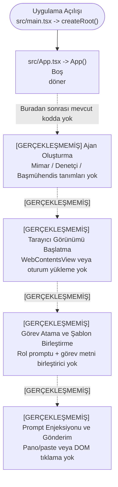
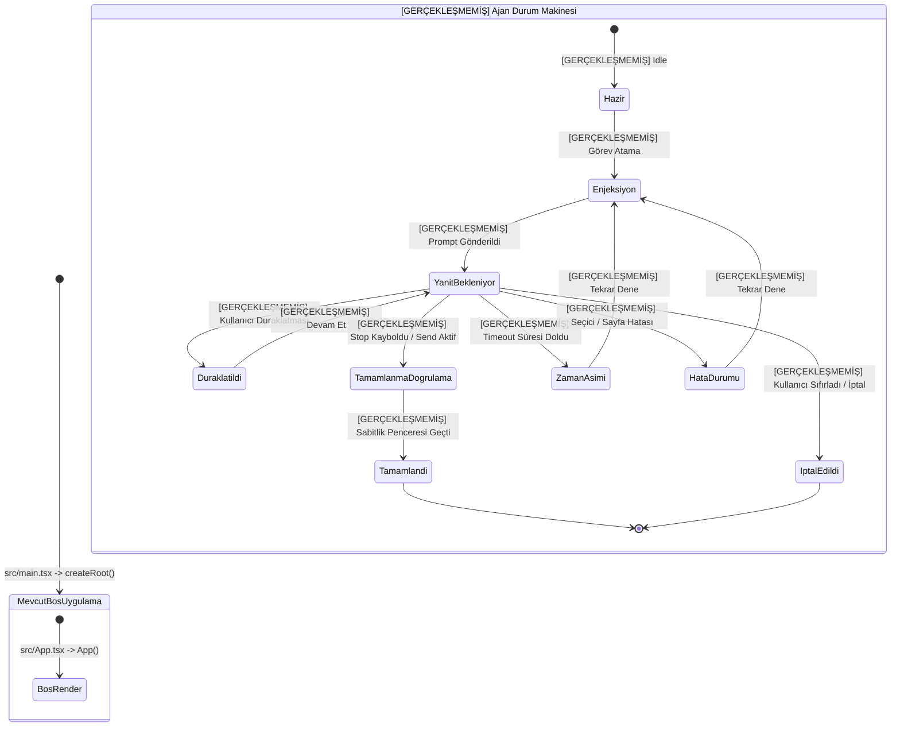
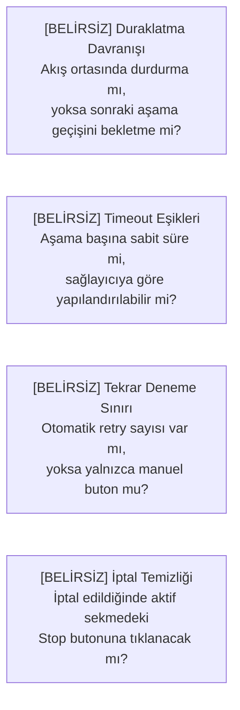

# 2. Ajan Yaşam Döngüsü (`agent-lifecycle.md`)

> **Doğrulama Özeti:** Mevcut kaynak kod incelenmiştir. Uygulamada herhangi bir yapay zekâ ajanı nesnesi, ajan havuzu, durum makinesi, zamanlayıcı (timeout), tekrar deneme veya duraklatma/devam ettirme mekanizması **bulunmamaktadır**. Tek yürütülen bileşen `src/App.tsx` içindeki boş `App()` fonksiyonudur.

## Gerçekleşmeyen Yaşam Döngüsü Durumu

| Yaşam Döngüsü Evresi | Durum | Gerçek Kaynak Dosyası / Fonksiyonu |
| :--- | :--- | :--- |
| Ajan Oluşturma ve Başlatma | `[GERÇEKLEŞMEMİŞ]` | Mevcut kodda yok |
| Görev Atama ve Prompt Gönderme | `[GERÇEKLEŞMEMİŞ]` | Mevcut kodda yok |
| Yanıt Bekleme ve Tamamlanma Algılama | `[GERÇEKLEŞMEMİŞ]` | Mevcut kodda yok |
| Timeout ve Tekrar Deneme (Retry) | `[GERÇEKLEŞMEMİŞ]` | Mevcut kodda yok |
| Duraklatma ve Devam Ettirme | `[GERÇEKLEŞMEMİŞ]` | Mevcut kodda yok |
| Hata ve İptal Durumları | `[GERÇEKLEŞMEMİŞ]` | Mevcut kodda yok |

---

## Alt Diyagram 1: Ajan Oluşturma, Başlatma ve Görev Atama Akışı

Mevcut kodda ajan örneği veya yapılandırma deposu bulunmadığından aşağıdaki adımların tamamı `[GERÇEKLEŞMEMİŞ]` olarak işaretlenmiştir.

- **Gerçek Kaynak Dosyaları ve Fonksiyonlar:**
  - `src/main.tsx`: `createRoot()` yalnızca React kökünü başlatır.
  - `src/App.tsx`: `App()` boş `

` döndürür; ajan listesi, state (`useState`/`useReducer`) veya efekt (`useEffect`) içermez.

---

## Alt Diyagram 2: Yanıt Bekleme, Tamamlanma Algılama ve Hata/Timeout Durumları

Yanıtın akış (streaming) halinden çıkıp tamamlandığını doğrulayan gözlemci, 3 dakikalık zaman aşımı (timeout), tekrar deneme ve iptal/duraklatma durum makinesi mevcut kodda yer almamaktadır.

---

## Alt Diyagram 3: Duraklatma, Devam Ettirme ve Tekrar Deneme Belirsizlikleri

Kod henüz yazılmadığı için kontrol akışında aşağıdaki noktalar **`[BELİRSİZ]`** durumdadır:

- **Sonuç:** Ajan yaşam döngüsüne ait hiçbir dosya, sınıf, hook veya zamanlayıcı fonksiyonu mevcut kaynak kodda bulunmamaktadır.
