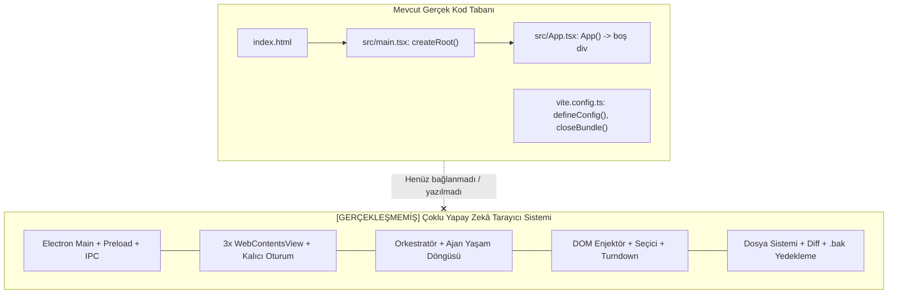

# 9. Mimari Dizin ve Genel Değerlendirme (`architecture-index.md`)

> **Ana Bulgu:** Çalışma alanı kaynak kodu incelenmiştir. İstenen **Multi-Agent AI Browser Studio** Electron masaüstü uygulaması henüz disk üzerinde kodlanmamıştır. Mevcut kod tabanı yalnızca boş bir **Vite + React** başlangıç şablonundan oluşmaktadır (`index.html`, `src/main.tsx`, `src/App.tsx`, `src/index.css`, `vite.config.ts`). Bu nedenle aşağıdaki belgelerde gerçek mevcut kod eksiksiz doğrulanmış, henüz yazılmamış tüm Electron ve çoklu ajan akışları ise **`[GERÇEKLEŞMEMİŞ]`** veya **`[BELİRSİZ]`** olarak işaretlenmiştir.

## Mimari Belgeler Dizini

1. [1. Sistem Mimarisi](./system-architecture.md) — Mevcut Vite+React yapısı ile eksik Electron/IPC/`WebContentsView`/dosya sistemi katmanları.
2. [2. Ajan Yaşam Döngüsü](./agent-lifecycle.md) — Oluşturma, atama, bekleme, timeout, retry, duraklatma ve iptal durumları.
3. [3. Tarayıcı Etkileşim Akışı](./browser-interaction.md) — Sayfa açılışı, `WebContentsView`, enjeksiyon, tamamlanma doğrulama ve DOM değişimi riskleri.
4. [4. Çoklu Ajan Orkestrasyonu](./multi-agent-orchestration.md) — Görev dağılımı, sıralı çalışma, bağlam aktarımı ve çakışma belirsizlikleri.
5. [5. Kod Üretim ve Dosya Yazma Hattı](./code-generation-pipeline.md) — Dosya okuma, kod bloğu ayrıştırma, diff önizleme, onay, yazma ve geri alma.
6. [6. Proje ve Plan Yönetimi](./project-and-plan-flow.md) — `plan_v1.md` / `plan_v2.md` / `plan_final.md` sürüm ilişkileri ve bağlam aktarımı.
7. [7. Hata ve Kurtarma Mimarisi](./error-recovery.md) — 8 kritik hata senaryosu ve eksik kurtarma yolları.
8. [8. Güvenlik ve İzolasyon](./security-boundaries.md) — Renderer/Main sınırları, IPC izinleri, güvenilmeyen HTML ve çalıştırma ayrımı.

---

## Genel Sistem Bağlam Haritası (Gerçek vs. Gerçekleşmemiş)

---

## Gerçek Kaynak Dosyaları Envanteri (Doğrulanmış)

| Dosya | Gerçek Fonksiyon / Yapı | Rolü |
| :--- | :--- | :--- |
| `index.html` | `#root`, `<script src="/src/main.tsx">` | Tarayıcı HTML giriş noktası |
| `src/main.tsx` | `createRoot(...)` | React 19 kök bileşen bağlama |
| `src/App.tsx` | `App()` | Yalnızca boş `

` döndürür |
| `src/index.css` | `@import "tailwindcss";` | Tailwind CSS v4 giriş dosyası |
| `vite.config.ts` | `defineConfig()`, `closeBundle()` | Vite eklentileri ve `src/assets` kopyalama kancası |
| `package.json` | `dev`, `build`, `preview`, `lint` | Bağımlılık ve betik tanımları (Electron yok) |
| `tsconfig.json` | TypeScript derleyici seçenekleri | Tür denetimi ayarları |
| `metadata.json` | Boş ad/açıklama + capability tanımı | Stüdyo meta verisi |

---

## Mimari Açıklar, Darboğazlar ve İyileştirme Önerileri Raporu

### 1. Kritik Mimari Açıklar (Gaps)

1. **Çekirdek Uygulama Katmanı Tamamen Eksik:** `main.js`, `preload.js`, `injector.js`, `selectors.json`, `renderer.js` ve Electron bağımlılıkları disk üzerinde yoktur; sistem henüz yürütülebilir bir masaüstü uygulaması değildir.
2. **Süreç ve Güvenlik İzolasyonu Yok:** Üçüncü parti yapay zekâ web sitelerini çalıştıracak `WebContentsView` ayrımı, `contextIsolation: true` ve Studio Renderer ile hedef web görünümleri arasında ayrı `preload` sınırları mevcut değildir.
3. **Veri Kalıcılığı ve Kurtarma Eksikliği:** Proje klasörü seçimi, `plan_v1.md` / `plan_v2.md` / `plan_final.md` sürümleme, beklenmedik kapanma sonrası checkpoint ve `.bak` yedekleme/geri alma mekanizmaları yoktur.
4. **Hata ve Çakışma Yönetimi Tanımsız:** 8 hata senaryosunun (ağ kopması, oturum düşmesi, seçici bozulması, aynı dosyaya yazma çakışması vb.) hiçbiri kodlanmamıştır.

### 2. Beklenen Darboğazlar (Bottlenecks)

1. **DOM Seçici Kırılganlığı:** Gemini, Claude, ChatGPT ve DeepSeek web arayüzleri sık güncellendiğinden tekil CSS seçicileri hızla bozulacaktır. Çoklu fallback seçici dizileri ve çalışma zamanı seçici doğrulama aracı olmadan otomasyon sık sık durur.
2. **Pano (Clipboard) Çakışması:** Prompt enjeksiyonunda `clipboard.writeText()` kullanıldığında kullanıcının kendi sistem panosu ezilebilir; işlem öncesi pano içeriğinin yedeklenip `paste()` sonrası geri yüklenmesi gerekir.
3. **Büyük Bağlam & Token Sınırı:** Tüm proje dosyalarının tek seferde yapay zekâ web arayüzüne yapıştırılması sitelerin karakter/bağlam sınırını aşabilir ve tarayıcı sekmesini yavaşlatabilir.
4. **Arka Plan Görünüm Kısıtlaması (Throttling):** Chromium görünür olmayan `WebContentsView` sekmelerinde zamanlayıcıları (`setTimeout` / `requestAnimationFrame`) yavaşlatabilir; `backgroundThrottling: false` ve boyut koruma stratejisi gerekir.

### 3. Önceliklendirilmiş İyileştirme Önerileri

1. **Öncelik 1 — Çekirdek Electron İskeletini Oluştur:** `main.js` (3x `WebContentsView`, `backgroundThrottling: false`, `partition: 'persist:agent_session'`), ayrı Studio `preload.js` ve ayrı View stealth `preload` katmanlarını hayata geçir.
2. **Öncelik 2 — Güvenli IPC ve Yol Doğrulama (Path Jail):** Main Process içindeki tüm `fs` yazma/yedekleme işlemlerinde `path.resolve` ile seçili proje kökü dışına çıkışı (`..`) engelleyen izin kontrolü ekle.
3. **Öncelik 3 — Akıllı Seçici ve Hata Kurtarma:** `selectors.json` için çoklu yedek seçici dizileri, `did-fail-load` / login-duvarı algılama, 3 dakikalık timeout ve pano geri yüklemeli enjeksiyon uygula.
4. **Öncelik 4 — Güvenli Kod Uygulama ve Çoklu Ajan Kilidi:** Dosyaya yazmadan önce diff önizleme + `.studio-backups/` altında zaman damgalı `.bak` alma + aynı dosyaya eşzamanlı yazımı önleyen dosya kilidi (write lock) ekle; kod yazma ile çalıştırma yetkisini kesin ayır.
5. **Öncelik 5 — Durum Kontrol Noktası (Checkpoint):** Her aşama geçişinde boru hattı durumunu proje klasöründe gizli bir `.studio-state.json` dosyasına yazarak çökme sonrası kaldığı yerden devam etmeyi sağla.
