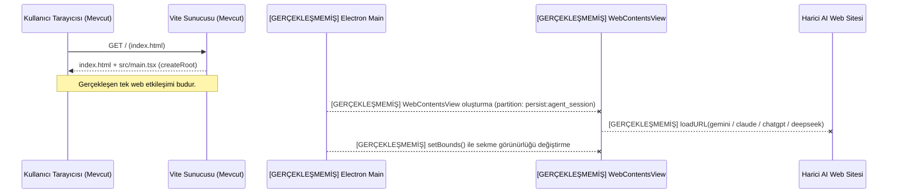
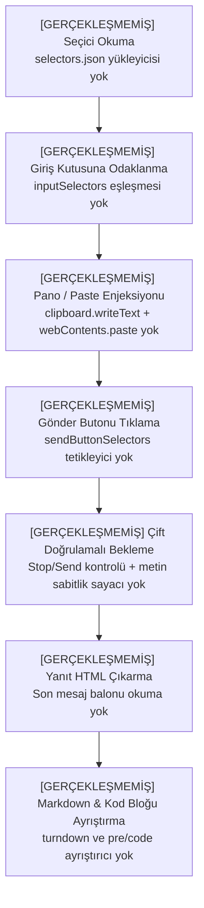
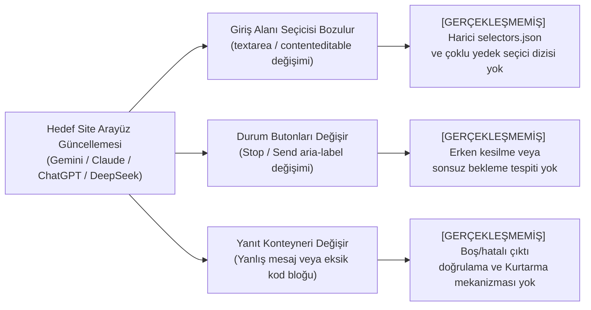

# 3. Tarayıcı Etkileşim Akışı (`browser-interaction.md`)

> **Doğrulama Özeti:** Mevcut kod tabanında Gemini, Claude, ChatGPT veya DeepSeek web arayüzlerine bağlanan, oturum açan, DOM seçicisi okuyan, prompt enjekte eden veya HTML yanıtını ayrıştıran **hiçbir modül bulunmamaktadır**.

## Tarayıcı Etkileşim Bileşenleri Doğrulaması

| Adım / Yetenek | Durum | Gerçek Kaynak Dosyası / Fonksiyonu |
| :--- | :--- | :--- |
| Hedef Yapay Zekâ Sayfasının Açılması | `[GERÇEKLEŞMEMİŞ]` | Mevcut kodda yok |
| Oturum ve `WebContentsView` Yönetimi | `[GERÇEKLEŞMEMİŞ]` | Mevcut kodda yok |
| Harici Seçici Yapılandırması (`selectors.json`) | `[GERÇEKLEŞMEMİŞ]` | Mevcut kodda yok |
| Prompt Enjeksiyonu (`clipboard` + `paste` vb.) | `[GERÇEKLEŞMEMİŞ]` | Mevcut kodda yok |
| Yanıt Tamamlanma Doğrulaması | `[GERÇEKLEŞMEMİŞ]` | Mevcut kodda yok |
| Yanıt Metni ve Kod Bloklarının Çıkarılması | `[GERÇEKLEŞMEMİŞ]` | Mevcut kodda yok |

---

## Alt Diyagram 1: Hedef Sayfa Açılışı ve Oturum / `WebContentsView` Akışı

Mevcut uygulamada tarayıcı içinde yalnızca Vite tarafından sunulan `index.html` yüklenir; harici yapay zekâ URL'lerini açan ikinci bir tarayıcı görünümü mevcut değildir.

---

## Alt Diyagram 2: Prompt Enjeksiyonu, Tamamlanma Doğrulama ve Çıkarım Hattı

Planlanan DOM köprüsü (injector), yapıştırma tabanlı enjeksiyon, `MutationObserver` + sabitlik kontrolü ve `turndown` ile HTML → Markdown dönüşümü mevcut kodda bulunmamaktadır.

- **Gerçek Kaynak Dosyası / Fonksiyonu:** Mevcut kodda yok (`package.json` içinde `turndown` veya benzeri bir paket kurulu değildir).

---

## Alt Diyagram 3: Web Arayüzü (DOM) Değişikliklerinin Sisteme Etkisi

Sistem resmî API yerine yapay zekâların halka açık web arayüzlerini hedeflediği için, hedef sitelerin DOM yapısındaki değişiklikler kritik kırılma noktası oluşturur. Mevcut kodda bu etkiyi azaltacak harici `selectors.json` mekanizması veya geri dönüş (fallback) stratejisi henüz uygulanmamıştır.

- **Belirsiz Noktalar (`[BELİRSİZ]`):**
  - Anti-bot / Cloudflare Turnstile veya Google oturum doğrulama engelleriyle karşılaşıldığında kullanıcının manuel müdahale edebilmesi için görünür tarayıcı odağının nasıl devredileceği mevcut kodda tanımsızdır.
  - Seçici eşleşmediğinde kullanıcıya arayüzde seçici test/onarım aracı sunulup sunulmayacağı henüz kodlanmamıştır.
