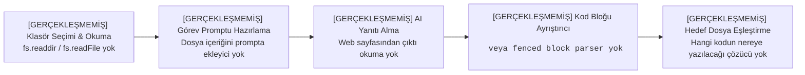
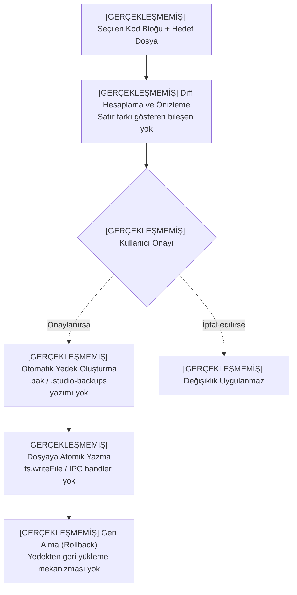

# 5. Kod Üretim ve Dosya Yazma Hattı (`code-generation-pipeline.md`)

> **Doğrulama Özeti:** Mevcut kaynak kod incelenmiştir. Proje dosyalarını okuyan, yapay zekâ yanıtındaki kod bloklarını ayrıştıran, diff önizlemesi gösteren, kullanıcı onayıyla diske yazan veya yedekleme/geri alma yapan **hiçbir boru hattı mevcut kodda bulunmamaktadır**.

## Kod Üretim Hattı Doğrulaması

| Boru Hattı Adımı | Durum | Gerçek Kaynak Dosyası / Fonksiyonu |
| :--- | :--- | :--- |
| Proje Dosyalarının Okunması | `[GERÇEKLEŞMEMİŞ]` | Mevcut kodda yok |
| Kodlama Görevinin Hazırlanması | `[GERÇEKLEŞMEMİŞ]` | Mevcut kodda yok |
| AI Yanıtının Alınması ve Ayrıştırılması | `[GERÇEKLEŞMEMİŞ]` | Mevcut kodda yok |
| Dosya ve Kod Değişikliklerinin Belirlenmesi | `[GERÇEKLEŞMEMİŞ]` | Mevcut kodda yok |
| Diff Önizlemesi | `[GERÇEKLEŞMEMİŞ]` | Mevcut kodda yok |
| Onay ve Dosyaya Yazma | `[GERÇEKLEŞMEMİŞ]` | Mevcut kodda yok |
| Yedekleme ve Geri Alma | `[GERÇEKLEŞMEMİŞ]` | Mevcut kodda yok |

---

## Alt Diyagram 1: Kod Okuma, Görev Hazırlama ve Yanıt Ayrıştırma

- **Gerçek Kaynak Dosyası / Fonksiyonu:** Mevcut kodda yok. `vite.config.ts` içindeki `closeBundle()` fonksiyonu yalnızca `vite build` sırasında `src/assets` dizinini `dist/src/assets` içine kopyalamakla görevlidir; kullanıcı proje dosyalarını okumak veya AI kodu yazmak için kullanılmaz.

---

## Alt Diyagram 2: Diff Önizleme, Onay, Dosyaya Yazma ve Yedekleme/Geri Alma

- **Belirsiz Noktalar (`[BELİRSİZ]`):**
  - AI yanıtı tam dosya yerine kısmi kod parçası (`... mevcut kod ...`) içerdiğinde akıllı yama (patch/AST merge) mı yapılacağı, yoksa tüm dosyanın mı üzerine yazılacağı mevcut kodda tanımlı değildir.
  - Çoklu dosya içeren tek bir AI yanıtının toplu (batch) uygulanıp uygulanamayacağı henüz kodlanmamıştır.
