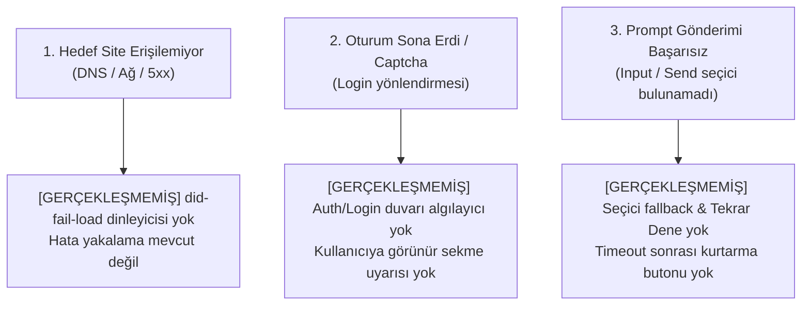
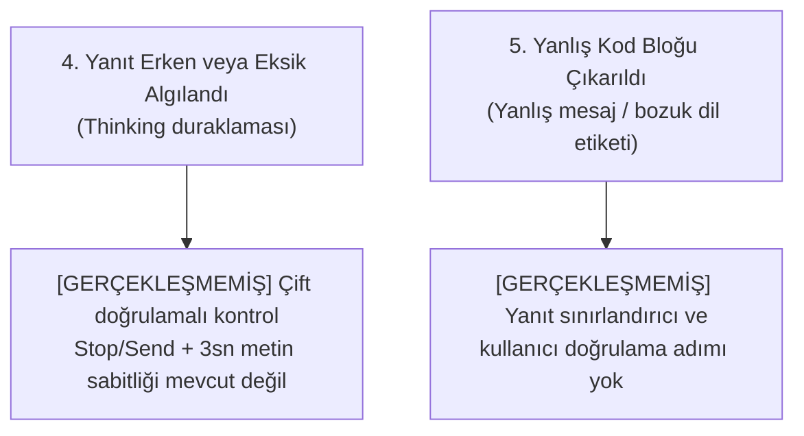
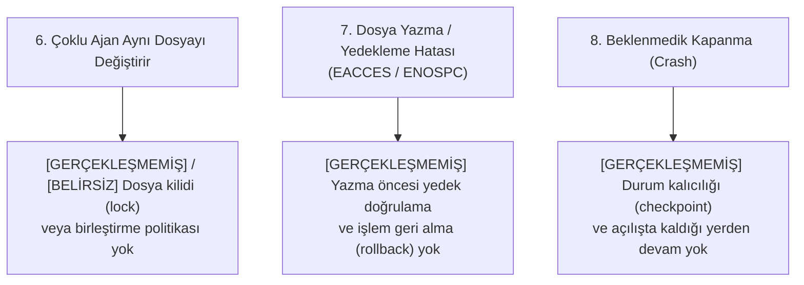

# 7. Hata ve Kurtarma Mimarisi (`error-recovery.md`)

> **Doğrulama Özeti:** Mevcut kaynak kodda (`src/App.tsx`, `src/main.tsx`, `vite.config.ts`) herhangi bir `try/catch` hata sınırı, React `ErrorBoundary`, ağ/oturum denetimi, zaman aşımı sayacı, yeniden deneme kuyruğu veya çökme kurtarma mekanizması **bulunmamaktadır**.

## İstenen 8 Hata Senaryosunun Gerçekleşme Durumu

| # | Hata Senaryosu | Mevcut Durum | Gerçek Kaynak Dosyası / Fonksiyonu |
| :--- | :--- | :--- | :--- |
| 1 | Hedef web sitesinin erişilememesi | `[GERÇEKLEŞMEMİŞ]` | Mevcut kodda yok |
| 2 | Oturumun sona ermesi (Login/Cloudflare) | `[GERÇEKLEŞMEMİŞ]` | Mevcut kodda yok |
| 3 | Prompt gönderiminin başarısız olması | `[GERÇEKLEŞMEMİŞ]` | Mevcut kodda yok |
| 4 | Yanıtın erken veya eksik algılanması | `[GERÇEKLEŞMEMİŞ]` | Mevcut kodda yok |
| 5 | Yanlış kod bloğunun çıkarılması | `[GERÇEKLEŞMEMİŞ]` | Mevcut kodda yok |
| 6 | Birden fazla ajanın aynı dosyayı değiştirmesi | `[GERÇEKLEŞMEMİŞ]` / `[BELİRSİZ]` | Mevcut kodda yok |
| 7 | Dosya yazma ve yedekleme hataları | `[GERÇEKLEŞMEMİŞ]` | Mevcut kodda yok |
| 8 | Uygulamanın beklenmedik kapanması | `[GERÇEKLEŞMEMİŞ]` | Mevcut kodda yok |

---

## Alt Diyagram 1: Ağ, Oturum ve Prompt Gönderim Hataları (Senaryo 1–3)

---

## Alt Diyagram 2: Yanıt Algılama ve Kod Bloğu Çıkarma Hataları (Senaryo 4–5)

---

## Alt Diyagram 3: Eşzamanlı Dosya Çakışması, Yazma Hatası ve Çökme Kurtarma (Senaryo 6–8)

- **Kritik Eksiklik:** Uygulamanın beklenmedik kapanması halinde boru hattı durumu (`pipelineState`) ve ara plan sürümleri diske otomatik checkpoint olarak kaydedilmediği için (şu an hiç durum yönetimi olmadığı için) kurtarma mümkün değildir.
