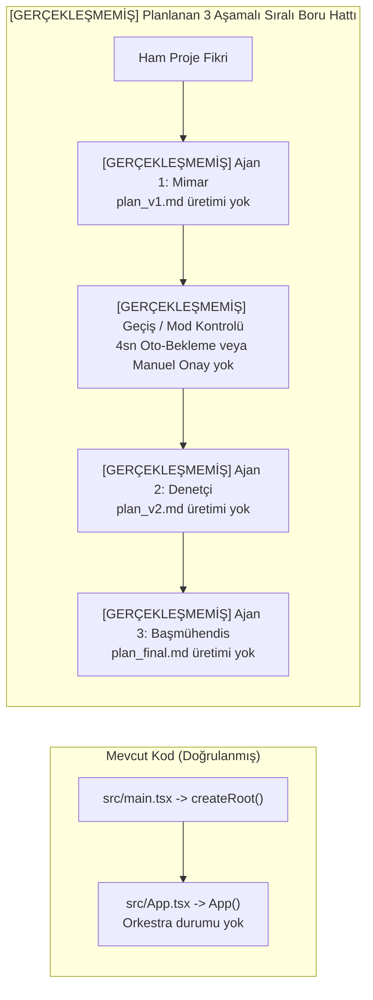
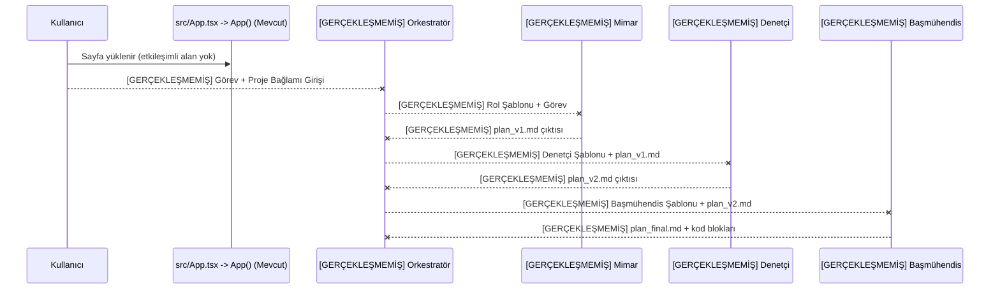
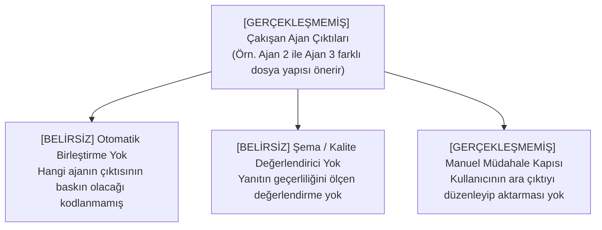

# 4. Çoklu Ajan Orkestrasyonu (`multi-agent-orchestration.md`)

> **Doğrulama Özeti:** Mevcut kaynak kod incelenmiştir. Uygulamada çoklu ajan boru hattı, görev dağıtıcısı, bağlam aktarım mekanizması, çıktı toplayıcı veya çakışma çözücü **bulunmamaktadır**. Aşağıdaki diyagramlar hem mevcut boş durumu hem de tanımlanmamış/gerçekleşmemiş orkestrasyon noktalarını göstermektedir.

## Orkestrasyon Yetenekleri Doğrulaması

| Orkestrasyon Başlığı | Durum | Gerçek Kaynak Dosyası / Fonksiyonu |
| :--- | :--- | :--- |
| Ajanlar Arası Görev Dağılımı | `[GERÇEKLEŞMEMİŞ]` | Mevcut kodda yok |
| Sıralı veya Bağımsız Çalışma İlişkisi | `[GERÇEKLEŞMEMİŞ]` | Mevcut kodda yok |
| Ortak Görev ve Proje Bağlamı Aktarımı | `[GERÇEKLEŞMEMİŞ]` | Mevcut kodda yok |
| Ajan Sonuçlarının Toplanması ve Değerlendirilmesi | `[GERÇEKLEŞMEMİŞ]` | Mevcut kodda yok |
| Çakışan / Uyumsuz Sonuçların Ele Alınması | `[GERÇEKLEŞMEMİŞ]` / `[BELİRSİZ]` | Mevcut kodda yok |

---

## Alt Diyagram 1: Mevcut Durum vs. Gerçekleşmemiş Sıralı Boru Hattı

- **Bağımsız vs. Sıralı Çalışma Durumu:** Mevcut kodda ne sıralı (pipeline) ne de paralel (bağımsız) çalışan bir ajan koordinatörü vardır. Birden fazla `WebContentsView` örneğinin arka planda açık tutulması yalnızca oturumların korunması içindir; eşzamanlı görev çalıştırıcı da mevcut kodda yoktur.

---

## Alt Diyagram 2: Bağlam Aktarımı ve Sonuç Toplama Eksikliği

---

## Alt Diyagram 3: Çakışan veya Uyumsuz Sonuçların Ele Alınması (`[BELİRSİZ]` Alanlar)

Ajanların farklı mimari kararlar üretmesi, önceki ajanın dosya adını değiştirmesi veya çelişkili kod blokları döndürmesi halinde nasıl karar verileceği mevcut kodda **tanımlanmamıştır**.

