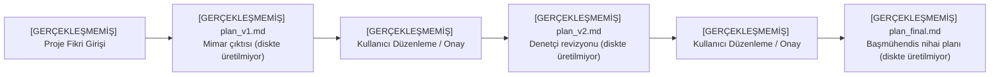
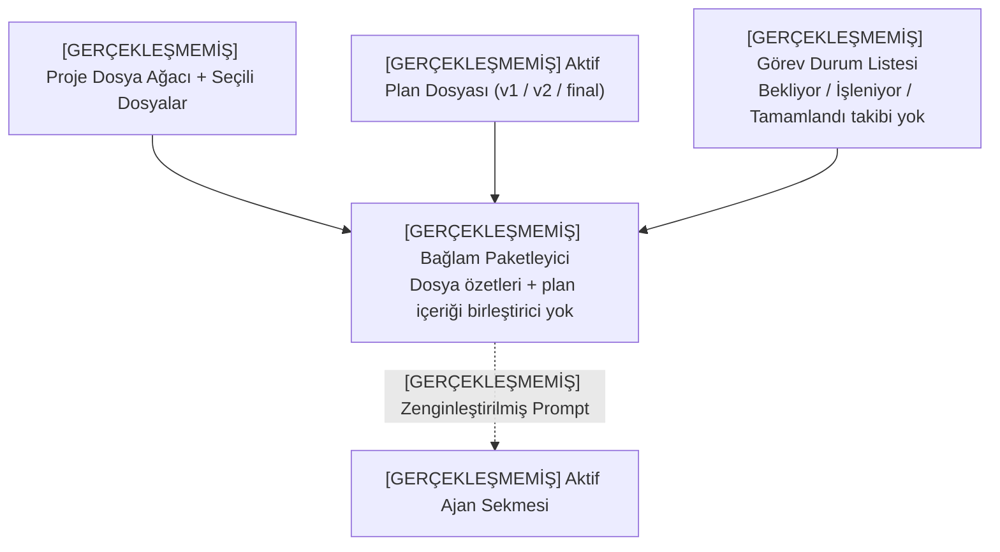

# 6. Proje ve Plan Yönetimi (`project-and-plan-flow.md`)

> **Doğrulama Özeti:** Mevcut kaynak kodda proje klasörünü yöneten, `plan_v1.md` / `plan_v2.md` / `plan_final.md` dosyalarını okuyan/güncelleyen, görev tamamlanma durumunu takip eden veya proje bağlamını ajanlara aktaran **hiçbir uygulama içi mekanizma bulunmamaktadır**.

## Plan ve Proje Yönetimi Doğrulaması

| Süreç | Durum | Gerçek Kaynak Dosyası / Fonksiyonu |
| :--- | :--- | :--- |
| Plan Dosyalarının Okunması ve Güncellenmesi | `[GERÇEKLEŞMEMİŞ]` | Mevcut kodda yok |
| Plan Sürümlerinin İlişkileri (`v1` -> `v2` -> `final`) | `[GERÇEKLEŞMEMİŞ]` | Mevcut kodda yok |
| Ajanların Plan Üzerinden Çalışması | `[GERÇEKLEŞMEMİŞ]` | Mevcut kodda yok |
| Görevlerin Tamamlanma Durumunun Yönetimi | `[GERÇEKLEŞMEMİŞ]` | Mevcut kodda yok |
| Proje Bağlamının Ajanlara Aktarılması | `[GERÇEKLEŞMEMİŞ]` | Mevcut kodda yok |

> **Ayırım Notu:** AI Studio çalışma alanı içinde yer alan `.aistudio/artifacts/.../implementation_plan.md` yalnızca geliştirme ortamının planlama artifaktıdır; uygulamanın kendi çalışma zamanı (`src/App.tsx`, `src/main.tsx`) tarafından okunmaz veya yönetilmez.

---

## Alt Diyagram 1: Plan Sürüm İlişkileri ve Okuma/Güncelleme Akışı

---

## Alt Diyagram 2: Ajanların Plan ve Proje Bağlamı Üzerinden Çalışması

- **Belirsiz Noktalar (`[BELİRSİZ]`):**
  - Çok büyük projelerde (`node_modules`, `dist`, büyük kod tabanları) hangi dosyaların bağlama dahil edilip hangilerinin dışlanacağına (ör. `.gitignore` filtresi veya token/karakter sınırı) dair hiçbir kural kodlanmamıştır.
  - `plan_final.md` üretildikten sonra içindeki alt görevlerin otomatik olarak tek tek kodlama görevlerine bölünüp bölünmeyeceği mevcut kodda tanımlı değildir.
