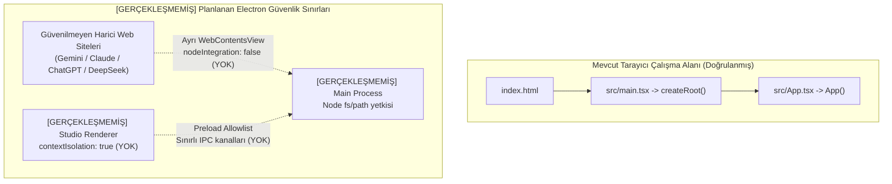
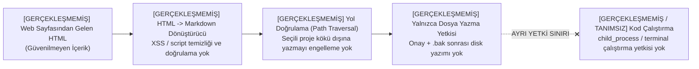

# 8. Güvenlik ve İzolasyon (`security-boundaries.md`)

> **Doğrulama Özeti:** Mevcut kod tabanı yalnızca boş bir Vite + React tarayıcı şablonudur (`index.html`, `src/main.tsx`, `src/App.tsx`). Electron süreç izolasyonu, IPC kanal izin listesi, ajan dosya erişim kısıtlaması, harici HTML arındırması ve kod çalıştırma ayrımı **mevcut kodda bulunmamaktadır**.

## Güvenlik Katmanları Doğrulaması

| Güvenlik Alanı | Durum | Gerçek Kaynak Dosyası / Fonksiyonu |
| :--- | :--- | :--- |
| Renderer ve Main Process Güvenlik Sınırları | `[GERÇEKLEŞMEMİŞ]` | Mevcut kodda Electron süreçleri yok (`src/App.tsx` yalnızca tarayıcı DOM'unda çalışır) |
| IPC Kanal İzinleri (Allowlist) | `[GERÇEKLEŞMEMİŞ]` | Mevcut kodda yok |
| Ajanların Dosya Erişim Yetkileri | `[GERÇEKLEŞMEMİŞ]` | Mevcut kodda dosya erişimi yok |
| Güvenilmeyen Web İçeriklerinin İşlenmesi | `[GERÇEKLEŞMEMİŞ]` | Mevcut kodda harici sayfa çekimi / HTML parse yok |
| Kod Yazma ve Çalıştırma Yetkilerinin Ayrımı | `[GERÇEKLEŞMEMİŞ]` | Mevcut kodda ne dosya yazma ne de kabuk çalıştırma (`child_process`) var |

---

## Alt Diyagram 1: Gerçek Mevcut Sınır vs. Gerçekleşmemiş Electron İzolasyon Sınırları

---

## Alt Diyagram 2: Dosya Erişim Yetkileri, Güvenilmeyen İçerik ve Çalıştırma Ayrımı

- **Gözlenen Gerçek Yapılandırma Riskleri (`vite.config.ts`, `metadata.json`):**
  - `package.json` içinde `@google/genai` ve `express` kurulu olup `metadata.json` içinde `MAJOR_CAPABILITY_SERVER_SIDE_GEMINI_API` tanımlıdır; ancak bu paketler kod içinde kullanılmamaktadır.
  - Electron tarafı yazıldığında özellikle `WebContentsView` içine yüklenen üçüncü parti sitelerin (ve olası reklam/XSS yüklerinin) hiçbir şekilde `preload` üzerinden dosya sistemi veya `clipboard` IPC kanallarına erişememesi için **Studio Renderer preload'u ile `WebContentsView` stealth preload'u kesin biçimde ayrılmalıdır**.
