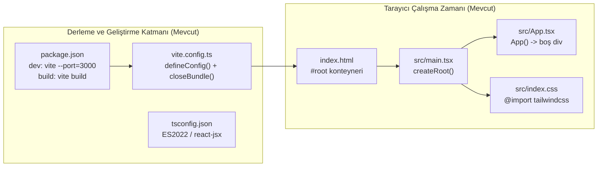
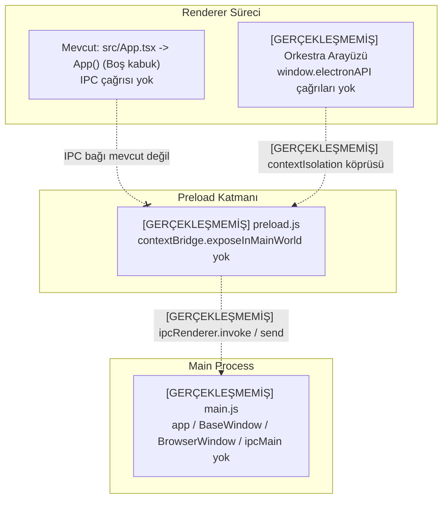
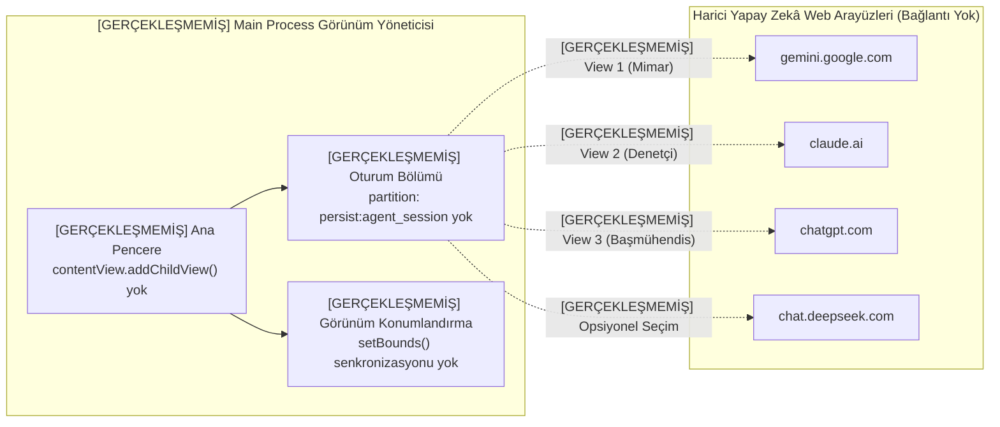
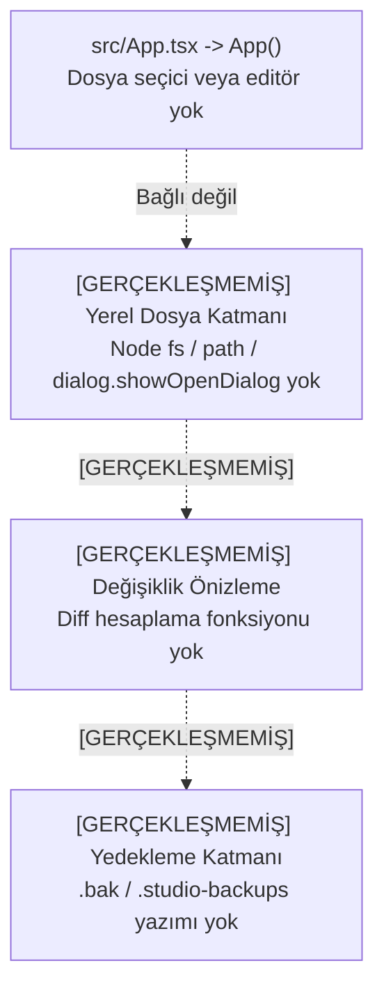

# 1. Sistem Mimarisi (`system-architecture.md`)

> **Doğrulama Özeti:** Çalışma alanı kaynak kodu incelenmiştir. Mevcut kod tabanı yalnızca başlangıç düzeyinde bir **Vite + React** web uygulaması iskeleti içermektedir. Electron ana süreci (`Main Process`), `Preload`, `IPC`, `WebContentsView`, harici seçici yapılandırması ve yerel dosya sistemi/yedekleme katmanı **mevcut kodda bulunmamaktadır**.

## Gerçek Mevcut Durum Envanteri

| Bileşen / Katman | Durum | Gerçek Kaynak Dosyası ve Fonksiyon / Sembol |
| :--- | :--- | :--- |
| Tarayıcı Giriş Sayfası | Mevcut | `index.html` (`
`, `/src/main.tsx` modül yükleme) |
| İstemci Kök Bağlama | Mevcut | `src/main.tsx` (`createRoot(document.getElementById('root')!).render(<App />)`) |
| Ana Arayüz Bileşeni | Mevcut (Boş) | `src/App.tsx` (`App()` — yalnızca boş `

` döndürür) |
| Stil Girişi | Mevcut (Temel) | `src/index.css` (`@import "tailwindcss";`) |
| Derleme / Geliştirme Aracı | Mevcut | `vite.config.ts` (`defineConfig()`, `copy-unbundled-src-assets` / `closeBundle()`) |
| Electron Main Process | `[GERÇEKLEŞMEMİŞ]` | Mevcut kodda yok (`electron` bağımlılığı `package.json` içinde yoktur) |
| Preload & ContextBridge | `[GERÇEKLEŞMEMİŞ]` | Mevcut kodda yok |
| Renderer / IPC İstemcisi | `[GERÇEKLEŞMEMİŞ]` | Mevcut kodda yok (`src/App.tsx` içinde herhangi bir IPC veya durum mantığı yoktur) |
| `WebContentsView` & Kalıcı Oturumlar | `[GERÇEKLEŞMEMİŞ]` | Mevcut kodda yok |
| Dosya Sistemi (`fs`/`path`) & Yedekleme | `[GERÇEKLEŞMEMİŞ]` | Mevcut kodda yok |

---

## Alt Diyagram 1: Gerçek Mevcut Çalışma Alanı Mimarisi

Aşağıdaki diyagram yalnızca şu anda disk üzerinde **fiilen çalışan** modülleri ve derleme zincirini göstermektedir.

- **Gerçek Kaynak Dosyaları ve Fonksiyonlar:**
  - `vite.config.ts`: `defineConfig()` içinde `react()`, `tailwindcss()` eklentilerini ve derleme sonrası `src/assets` kopyalayan `closeBundle()` kancasını tanımlar.
  - `index.html`: `#root` düğümünü tanımlar ve `<script type="module" src="/src/main.tsx">` ile React uygulamasını yükler.
  - `src/main.tsx`: `createRoot(document.getElementById('root')!).render(<App />)` çağrısı ile `App` bileşenini bağlar.
  - `src/App.tsx`: `export default function App()` yalnızca boş `

` döndürür.

---

## Alt Diyagram 2: Renderer, Main Process, Preload ve IPC İlişkileri

Hedeflenen Electron mimarisindeki süreçler arası sınırların tamamı şu anda **`[GERÇEKLEŞMEMİŞ]`** durumdadır.

- **Gerçek Kaynak Dosyası / Fonksiyonu:** Renderer yalnızca `src/App.tsx` (`App()`) ve `src/main.tsx` (`createRoot()`) ile sınırlıdır. Main Process, Preload ve IPC kanalları mevcut kodda yoktur.

---

## Alt Diyagram 3: `WebContentsView` ve Tarayıcı Oturum Yönetimi

Gemini, Claude, ChatGPT ve DeepSeek web oturumlarını kalıcı tutacak `WebContentsView` ve bölüm (`partition`) katmanı henüz yazılmamıştır.

- **Gerçek Kaynak Dosyası / Fonksiyonu:** Mevcut kodda yok. `package.json` içinde `electron` paketi ve giriş noktası (`main`) tanımlı değildir.

---

## Alt Diyagram 4: Dosya Sistemi ve Yedekleme Katmanı

Yerel proje klasörünü okuma, plan `.md` dosyalarını yazma ve değişiklik öncesi yedek alma katmanı mevcut kodda bulunmamaktadır.

- **Not (`package.json` Bağımlılık Gözlemi):** `package.json` dosyasında `express`, `dotenv` ve `@google/genai` paketleri kurulu görünmekle birlikte, çalışma alanında bu paketleri içe aktaran herhangi bir sunucu dosyası (`server.ts`) veya istemci modülü **bulunmamaktadır**.
